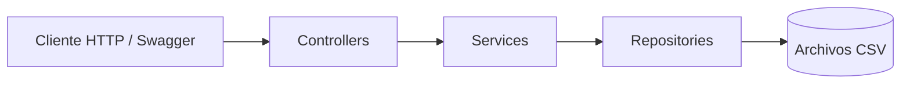

<div align="center">

# 👟 STREETWEAR API
### Catálogo urbano · Facturación · Control de stock

Una API REST para una tienda de sneakers, construida con **C# y ASP.NET Core**.


**Proyecto final · Paradigmas de Programación · Equipo de 3 integrantes**

🚧 **En desarrollo — Products implementado; facturación pendiente**

</div>

---

## ✨ Sobre el proyecto

**Streetwear API** es un proyecto académico para gestionar una tienda de tenis mediante HTTP. La solución final permitirá consultar el catálogo, abrir facturas, agregar productos y cerrar ventas, controlando las existencias y conservando los precios históricos.

El catálogo usa modelos reales de Nike, adidas, New Balance, Vans y Converse. Los precios, códigos internos y existencias son datos ficticios de prueba.

> Desarrollado sobre **MyRealAPI**, el proyecto base proporcionado por el profesor. Streetwear API es el nombre de presentación; la solución y los namespaces conservan MyRealAPI.

## 🎯 Objetivos

- Consultar un catálogo precargado de sneakers.
- Gestionar facturas abiertas y cerradas.
- Registrar detalles con el precio y la descripción del momento de la venta.
- Descontar stock al agregar productos a una factura.
- Recuperar la información después de reiniciar la API.
- Aplicar arquitectura por capas, interfaces, DTOs e inyección de dependencias.

## 🛠️ Tecnologías

| Tecnología | Uso |
| :--- | :--- |
| **C# / .NET 10** | Lenguaje y plataforma de desarrollo |
| **ASP.NET Core Web API** | Endpoints y procesamiento de solicitudes HTTP |
| **CsvHelper 33.1.0** | Lectura y escritura de archivos CSV |
| **Microsoft.AspNetCore.OpenApi 10.0.13** | Especificación OpenAPI |
| **Swashbuckle.AspNetCore.SwaggerUI 10.3.1** | Interfaz para explorar y probar la API |
| **Visual Studio** | Desarrollo, compilación y ejecución |
| **Git / GitHub** | Control de versiones y colaboración |
| **Draw.io** | Diagrama UML de la entrega final |

> La persistencia utiliza CSV. No se requiere una base de datos ni una interfaz gráfica de tienda: Swagger permite probar las operaciones.

## 🏗️ Arquitectura



| Componente | Responsabilidad |
| :--- | :--- |
| **Controllers** | Recibir peticiones y devolver respuestas HTTP |
| **Services** | Coordinar operaciones, aplicar reglas de negocio y preparar DTOs |
| **Repositories** | Consultar y guardar datos con CsvHelper |
| **Models** | Representar las entidades internas |
| **DTOs** | Definir los datos que entran y salen por la API |
| **Program.cs** | Configurar la aplicación y registrar dependencias |

Las dependencias se reciben por constructor. Los endpoints exponen **DTOs**, no entidades internas.

### Estructura actual

```text
MyRealAPI/
├── README.md
├── LEEME.md
├── VERIFICACION.md
├── MyRealAPI.slnx
└── MyRealAPI/
    ├── Controllers/
    │   └── ProductController.cs
    ├── DTOs/
    │   └── ProductResponseDto.cs
    ├── Models/
    │   └── Product.cs
    ├── Repositories/
    │   ├── IProductRepository.cs
    │   └── ProductRepository.cs
    ├── Services/
    │   ├── IProductService.cs
    │   └── ProductService.cs
    ├── Data/
    │   └── products.csv
    ├── Properties/
    │   └── launchSettings.json
    ├── MyRealAPI.csproj
    ├── MyRealAPI.http
    └── Program.cs
```

Receipt y DetailReceipt se incorporarán siguiendo la misma organización.

## 📦 Módulos y avance

| Módulo | Funcionalidad | Estado |
| :--- | :--- | :---: |
| **Products** | Listar y consultar productos | ✅ Implementado |
| **Receipt** | Abrir, consultar y cerrar facturas | 🟡 Pendiente |
| **DetailReceipt** | Agregar productos, conservar precios y descontar stock | 🟡 Pendiente |
| **Integración** | Coordinar ventas y persistencia entre módulos | 🟡 Pendiente |

### Products

Catálogo precargado con identificador, código, nombre, descripción, precio y stock. Solo expone consultas: no hay endpoints para crear, editar o eliminar productos.

El repositorio ofrece un método interno para guardar el stock. **La operación completa de venta todavía está pendiente.**

### Receipt

Cada factura tendrá número, fecha, documento y nombre del cliente, estado y total calculado por el sistema. Podrá consultarse junto con sus detalles.

### DetailReceipt

Cada detalle conservará una copia de la descripción y del precio unitario, además de cantidad y subtotal. Se creará desde una factura y se consultará con ella; **no tendrá endpoints independientes**.

## 🌐 Endpoints

**URL local:** `http://localhost:5062`

| Método | Ruta | Operación | Estado |
| :---: | :--- | :--- | :---: |
| `GET` | `/api/products` | Listar productos | ✅ |
| `GET` | `/api/products/{id}` | Consultar un producto | ✅ |
| `GET` | `/api/receipts` | Listar facturas | 🟡 |
| `GET` | `/api/receipts/{id}` | Consultar factura con detalles | 🟡 |
| `POST` | `/api/receipts` | Abrir factura | 🟡 |
| `POST` | `/api/receipts/{id}/details` | Agregar producto | 🟡 |
| `POST` | `/api/receipts/{id}/close` | Cerrar factura | 🟡 |

✅ Disponible · 🟡 Planificado

<details>
<summary><strong>📄 Respuesta de ejemplo: GET /api/products/1</strong></summary>

```json
{
  "id": 1,
  "code": "TEN-001",
  "name": "Nike Air Force 1 '07",
  "description": "Nike Air Force 1 '07 blancos talla 40",
  "price": 550000,
  "stock": 12
}
```

</details>

<details>
<summary><strong>🧾 Entrada prevista para agregar un detalle</strong></summary>

```http
POST /api/receipts/{id}/details
Content-Type: application/json
```

```json
{
  "productId": 1,
  "quantity": 2
}
```

El cliente envía el producto y la cantidad. El servidor determina el precio y los importes. Este endpoint está pendiente de implementación.

</details>

## 👟 Catálogo

| ID | Modelo | Variante | Precio de prueba (COP) | Pares |
| :---: | :--- | :--- | ---: | ---: |
| 1 | Nike Air Force 1 '07 | Blancos · talla 40 | 550.000 | 12 |
| 2 | adidas Samba OG | Negros con blanco · talla 41 | 520.000 | 20 |
| 3 | New Balance 550 | Blancos con verde · talla 42 | 620.000 | 6 |
| 4 | Vans Old Skool | Negros con blanco · talla 39 | 320.000 | 8 |
| 5 | Converse Chuck 70 | Caña alta negros · talla 40 | 380.000 | 0 |

Cada fila representa una combinación de modelo, color y talla. El stock cuenta **pares**. Para este alcance, talla y color se incluyen en `Description`.

## 📐 Reglas de negocio

Estas reglas definen el comportamiento de la **solución final**; las de facturación están pendientes de implementación:

- La cantidad agregada debe ser positiva.
- Si el stock es insuficiente, el detalle no se registra.
- El stock se descuenta al agregar el detalle, no nuevamente al cerrar la factura.
- El subtotal se calcula a partir del precio unitario guardado y la cantidad.
- El total de la factura es la suma de sus subtotales.
- Una factura sin detalles no se puede cerrar.
- Una factura cerrada no se puede modificar ni eliminar.
- Los cambios posteriores en el catálogo no alteran los datos históricos del detalle.
- La API no acepta precios, subtotales ni totales enviados por el cliente.

## 💾 Persistencia

| Archivo | Datos | Estado |
| :--- | :--- | :---: |
| `Data/products.csv` | Catálogo y stock | ✅ Incluido |
| `Data/receipts.csv` | Facturas | 🟡 Pendiente |
| `Data/details.csv` | Detalles asociados a cada factura | 🟡 Pendiente |

CsvHelper se encarga de leer y escribir los archivos. El catálogo se carga al iniciar la API y el método interno de actualización de stock guarda los cambios en disco.

**Pendiente de integración:** coordinar stock, detalle y factura para evitar inconsistencias si una venta falla o llegan solicitudes simultáneas. Guardar un CSV por separado no equivale a una transacción completa.

## 🚀 Ejecución local

### Requisitos

- SDK de **.NET 10**.
- Visual Studio compatible con .NET 10 y la carga de trabajo **Desarrollo de ASP.NET y web**.
- Acceso a NuGet para restaurar los paquetes inicialmente.

### Desde Visual Studio

1. Clona el repositorio o extrae el proyecto completo.
2. Abre `MyRealAPI.slnx`.
3. Espera a que se restauren los paquetes NuGet.
4. Selecciona el proyecto **MyRealAPI** y el perfil **http**.
5. Ejecuta con **Ctrl + F5**.
6. Abre [Swagger local](http://localhost:5062/swagger).

### Desde la terminal

Desde la carpeta que contiene `MyRealAPI.slnx`:

```bash
dotnet restore MyRealAPI.slnx
dotnet run --project MyRealAPI/MyRealAPI.csproj --launch-profile http
```

Swagger está habilitado en **Development**, configurado por ese perfil. El catálogo debe estar en `MyRealAPI/Data/products.csv`.

## 🧪 Pruebas

En Swagger, despliega una operación, pulsa **Try it out** y luego **Execute**.

| Escenario | Solicitud | Resultado esperado |
| :--- | :--- | :--- |
| Catálogo completo | `GET /api/products` | `200` y cinco productos |
| Producto existente | `GET /api/products/1` | `200` y Nike Air Force 1 '07 |
| Producto inexistente | `GET /api/products/999` | `404` y mensaje explicativo |
| Producto agotado | `GET /api/products/5` | `200` y stock cero |

Para comprobar la carga del CSV, detén la API, modifica un stock, guarda y vuelve a ejecutarla. La consulta debe mostrar el cambio. Esto comprueba la lectura del catálogo; no simula una venta.

`MyRealAPI.http` contiene consultas listas para ejecutar. `VERIFICACION.md` documenta las comprobaciones realizadas durante la preparación del módulo; esta entrega no incluye un proyecto de pruebas automatizadas.

### Pruebas pendientes de integración

- [ ] Abrir una factura y agregar un producto.
- [ ] Verificar subtotal, total y descuento de stock.
- [ ] Rechazar cantidades inválidas y stock insuficiente.
- [ ] Rechazar el cierre de una factura vacía.
- [ ] Impedir cambios en una factura cerrada.
- [ ] Conservar precios históricos ante cambios en el catálogo.
- [ ] Reiniciar la API y recuperar facturas, detalles y stock.
- [ ] Comprobar consistencia ante solicitudes simultáneas y fallos de guardado.

## 🤝 Organización del equipo

| Responsable | Alcance |
| :--- | :--- |
| **Integrante 1** | Products, catálogo CSV y preparación de la base común |
| **Integrante 2** | Receipt: apertura, consultas, estado, cierre y total |
| **Integrante 3** | DetailReceipt: cantidades, precios históricos y descuento de stock |
| **Todo el equipo** | Integración, pruebas finales, UML y sustentación |

Cada integrante desarrolla las capas de su módulo y debe comprender cómo se conecta con los demás.

## 📋 Entregables

- [x] Products y catálogo precargado.
- [x] Swagger disponible para las consultas de productos.
- [ ] Receipt completo.
- [ ] DetailReceipt completo.
- [ ] Persistencia integrada de las tres entidades.
- [ ] Swagger con todos los endpoints exigidos.
- [ ] Diagrama UML en Draw.io consistente con el código final.
- [ ] Solución completa comprimida con archivos CSV.
- [ ] Sustentación individual de cada integrante.

## 📚 Referencia académica

Desarrollado a partir del [enunciado del proyecto final de Paradigmas de Programación](https://paradigmas-talleres.pages.dev/#/4/3) y del proyecto base MyRealAPI proporcionado por el profesor.

---

<div align="center">

**👟 STREETWEAR API**  
*C# · Arquitectura por capas · APIs REST · Persistencia CSV*

</div>
